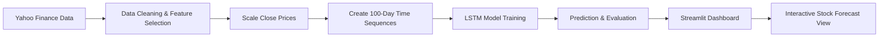
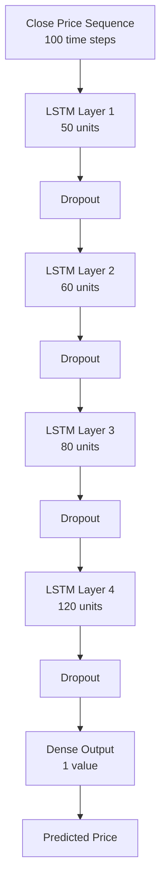
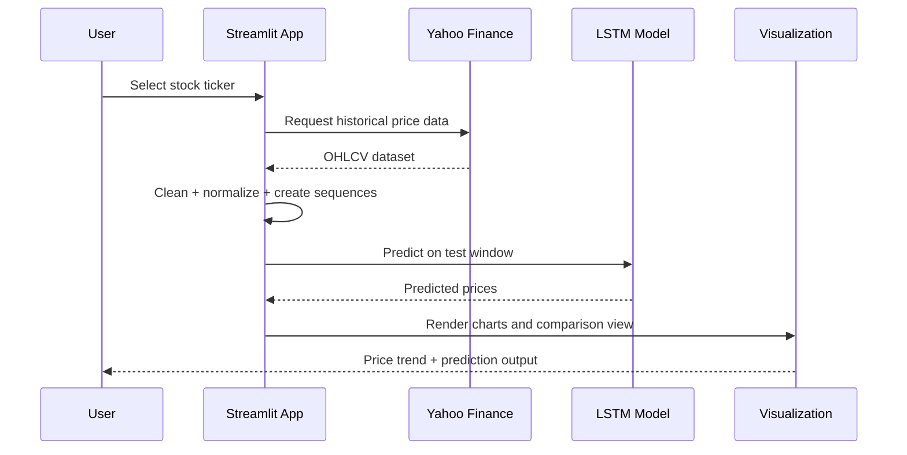

# Stock Price Prediction with LSTM

<div align="center">
  
  
  
</div>

A machine learning project for forecasting stock prices using historical market trends. The application combines time-series analysis, deep learning, and an interactive dashboard to predict future behavior of a stock based on previous closing prices.

## Overview

This project demonstrates how a Long Short-Term Memory (LSTM) neural network can learn sequential patterns from stock market data and predict future prices. It retrieves historical stock price data from Yahoo Finance, preprocesses the values, trains an LSTM model, and visualizes the results through a web application powered by Streamlit.

The workflow is designed for education and experimentation, making it easy to understand how stock price forecasting works from raw data to model output.

## Why this project matters

Stock markets are highly non-linear and influenced by many factors, including historical movement, volatility, sentiment, and macroeconomic conditions. Even though predicting prices perfectly is not possible, sequence-based models such as LSTM are well-suited to learning temporal dependencies from past prices.

This project helps bridge the gap between theoretical deep learning concepts and practical implementation by showing:

- how to collect time-series market data,
- how to normalize and structure it for model training,
- how to build an LSTM forecasting pipeline,
- how to evaluate predictions visually,
- and how to deploy the solution in an interactive dashboard.

## System architecture



## Model architecture



The model uses a stacked LSTM architecture with dropout layers to reduce overfitting. The input sequence is built from the previous 100 days of closing prices, and the output predicts the next price point based on that sequence.

## Project structure

```text
Stock Price prediction/
├── app.py                  # Streamlit dashboard and prediction pipeline
├── LSTM model.ipynb        # Notebook containing model development and experiments
├── keras_model.h5          # Trained Keras LSTM model saved to disk
├── .ipynb_checkpoints/     # Jupyter checkpoint files (auto-generated)
└── README.md               # Project documentation
```

## Features

- Historical stock data download through Yahoo Finance
- Interactive stock ticker input
- Data exploration with summary statistics
- Price visualization with moving averages
- Normalized feature preparation for deep learning
- LSTM-based forecasting
- Comparison between original and predicted values
- Clean web dashboard using Streamlit

## Workflow

### 1. Data acquisition
The application downloads historical close-price data for a selected stock using Yahoo Finance. A typical range is between 2010 and 2019 in this project.

### 2. Data preprocessing
The close-price series is transformed into a supervised time-series format. This includes:

- selecting the closing price feature,
- splitting the dataset into train/test subsets,
- scaling values using Min-Max normalization,
- creating rolling windows of 100 days to generate model inputs.

### 3. Model training
The model is trained as a sequence learning problem, where the network learns from previous daily closing prices to estimate the next price value in the sequence.

### 4. Evaluation and visualization
The trained model is tested on unseen stock data. The output is plotted against actual prices so that the forecast quality can be visually assessed.

## Data pipeline



## Technologies used

- Python
- Streamlit
- TensorFlow / Keras
- NumPy
- Pandas
- Matplotlib
- scikit-learn
- yfinance
- pandas_datareader

## Installation

Create a virtual environment and install the required dependencies:

```bash
python -m venv .venv
```

On Windows:

```powershell
.venv\Scripts\Activate.ps1
pip install numpy pandas matplotlib pandas_datareader yfinance scikit-learn tensorflow keras streamlit
```

On macOS/Linux:

```bash
source .venv/bin/activate
pip install numpy pandas matplotlib pandas_datareader yfinance scikit-learn tensorflow keras streamlit
```

## Running the project

Start the Streamlit app from the project directory:

```bash
streamlit run app.py
```

Then open the local URL shown in the terminal, typically:

```text
http://localhost:8501
```

## Usage

1. Launch the dashboard.
2. Enter a stock ticker such as `AAPL`, `MSFT`, or `GOOG`.
3. Review the historical price chart and moving average plots.
4. Examine the prediction graph comparing actual versus predicted values.
5. Use the results to understand how the LSTM model learns sequence-based patterns in price motion.

## Model assumptions and limitations

This project is a practical demonstration rather than a financial trading system. Some important limitations include:

- historical price data alone does not capture all real-world market drivers,
- stock prices are noisy and highly volatile,
- the model is trained on a single feature (closing price),
- predictions are not guaranteed to be profitable or accurate over long horizons,
- macroeconomic, sentiment, and news-based effects are not included.

## Results interpretation

The model compares predicted and actual prices over the test segment of the time series. This provides a visual understanding of how effectively the network captures short-term fluctuations and trend behavior.

In the dashboard, you will usually see:

- raw closing price trends,
- moving average overlays,
- and a forecast-versus-actual plot to assess alignment.

## Potential enhancements

The project can be expanded with several improvements:

- add more technical indicators (RSI, MACD, volume, volatility),
- support multi-stock prediction,
- compare LSTM with GRU, Bi-LSTM, or Transformer models,
- include feature engineering for sentiment and market regime filters,
- create a production-ready forecasting pipeline with backtesting,
- deploy the app to a cloud platform for public access.

## Conclusion

This project showcases a complete deep learning workflow for stock price prediction using LSTM. It combines data collection, preprocessing, model training, and visualization into a single workflow that is easy to explore and extend. It is a strong starting point for learning time-series forecasting and applying neural networks to real-world financial data.

## License

This project is intended for educational and research purposes. If you plan to use or extend it commercially, make sure you review the licensing terms of the underlying libraries and market data sources.
